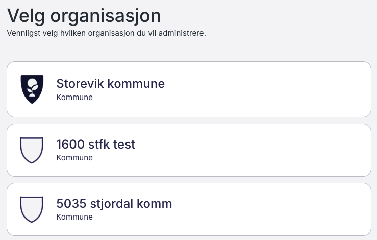

# Storevik kommune til topps 🚀

En liten nettleserutvidelse (Chrome/Edge/Brave, Manifest V3) som flytter "Storevik kommune"
til toppen av organisasjonslisten på Fiks-forvaltning, slik at man slipper å scrolle eller <kbd>CTRL</kbd>/<kbd>Cmd</kbd> + <kbd>F</kbd> for å finne den.

## Installasjon (last inn som utpakket utvidelse) 🔧

1. Clone repoet.
2. Åpne `chrome://extensions` (eller `brave://extensions`) i nettleseren.
3. Skru på "Utviklermodus" ("Developer mode").
4. Klikk "Last inn utpakket" ("Load unpacked") og velg mappen `storevik-extension`.
